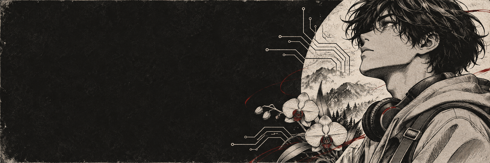

<h1>ANDRÉS DANIEL MEDINA ERAZO</h1>

<samp>SYSTEMS ENGINEERING · UNIVERSIDAD DEL CAUCA · POPAYÁN, COLOMBIA</samp>

 

<a href="#about">About</a> · <a href="#work">Selected work</a> · <a href="#toolkit">Toolkit</a> · <a href="#exploring">Exploring</a> · <a href="#connect">Connect</a>

---

<h2 id="about">A little about me</h2>

I'm **Andrés Daniel Medina Erazo**, a **Systems Engineering student at Universidad del Cauca** in Popayán, Colombia. I enjoy making software useful and understandable for the people who use it. I'm still exploring where I want to specialize, so I learn by building across mobile apps, web interfaces, APIs, and data.

Recently, I've been contributing to **Terravia / La Orquídea**, a team project that brings the biodiversity of a local wetland closer to visitors. My work has included mobile screens, QR-based access to species information, announcements, and integration with backend services.

- **On real devices:** I use testing feedback to improve mobile flows, from QR scanning to navigation and visual contrast.
- **In a team:** I document API contracts and coordinate frontend changes with backend work.

<h2 id="work">Selected work</h2>

### 🌿 [Terravia · La Orquídea](https://github.com/FaberGG/orquidea-mobile-app)

**Environmental education · Mobile app · Team project**

A mobile experience for discovering species and exploring a wetland in Popayán. I contribute to the app's frontend and its connection to the API, including flows around species cards, QR codes, announcements, and the interactive map.

`React Native` · `Expo` · `TypeScript` · `REST APIs`

[Explore the mobile app →](https://github.com/FaberGG/orquidea-mobile-app) &nbsp;·&nbsp; [See the backend →](https://github.com/FaberGG/orquidea-backend)

### 🩺 [Piedra Azul](https://github.com/DayanapOrtilla/Proyecto-Piedra-azul)

**Healthcare scheduling · Web and API · Team project**

An academic appointment management system. Working on the project helped me practice how interfaces, API modules, and a relational database fit together in a shared codebase.

`TypeScript` · `NestJS` · `PostgreSQL` · `Docker`

[Explore the project →](https://github.com/DayanapOrtilla/Proyecto-Piedra-azul) &nbsp;·&nbsp; [Backend repository →](https://github.com/DayanapOrtilla/Piedra-Azul-Backend)

<b>More academic experiments</b>

 

- **[Task manager with Meteor + React](https://github.com/DANIELMEDINA0408/meteor-task-manager-group5):** a visual and structural base for managing tasks and categories, built for a team presentation.
- **[Appointment manager with Meteor + React](https://github.com/DANIELMEDINA0408/gestor-citas-meteor-group5):** an academic prototype for patient and appointment records.
- **[Object-oriented programming](https://github.com/DANIELMEDINA0408/POO):** early programming coursework.

<h2 id="toolkit">Toolkit I have worked with</h2>

**Interfaces and apps** 

**Services, data, and collaboration** 

<h2 id="exploring">Currently exploring</h2>

- How to design mobile experiences that stay clear and accessible in real use.
- Software architecture, distributed systems, and the fundamentals of AI.
- Better ways to test, document, and deliver work as a team.

<h2 id="connect">Let's connect</h2>

I'm open to learning with other developers and collaborating on projects with a practical impact. You can find me on [LinkedIn](https://www.linkedin.com/in/daniel-medina-463301296/) or browse my [repositories](https://github.com/DANIELMEDINA0408?tab=repositories).

<a href="#top">↑ Back to top</a>

